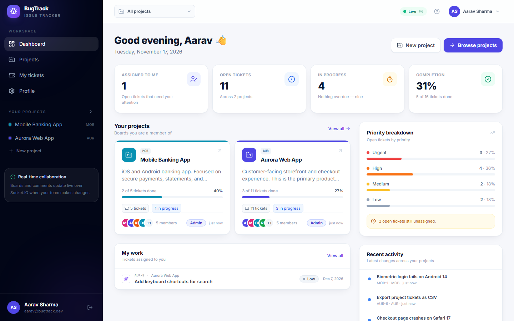
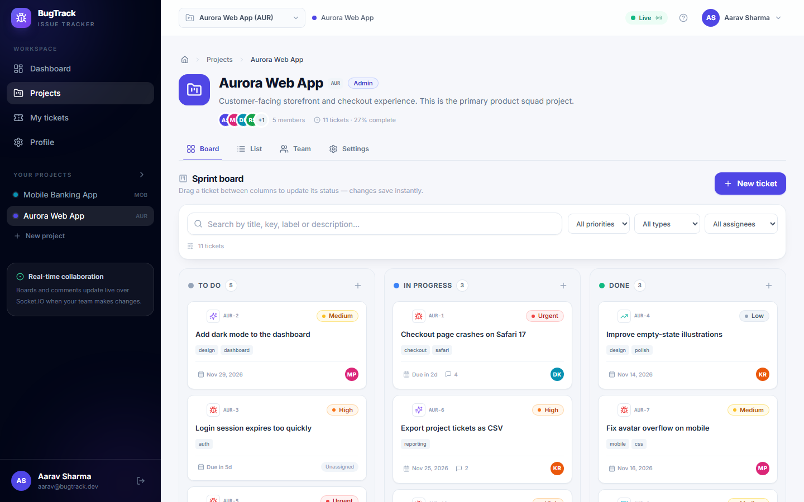
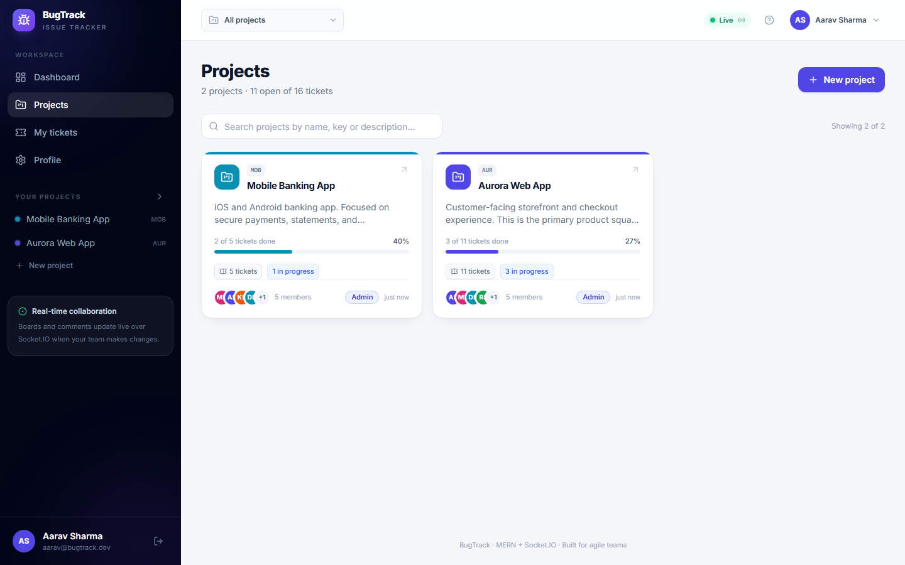
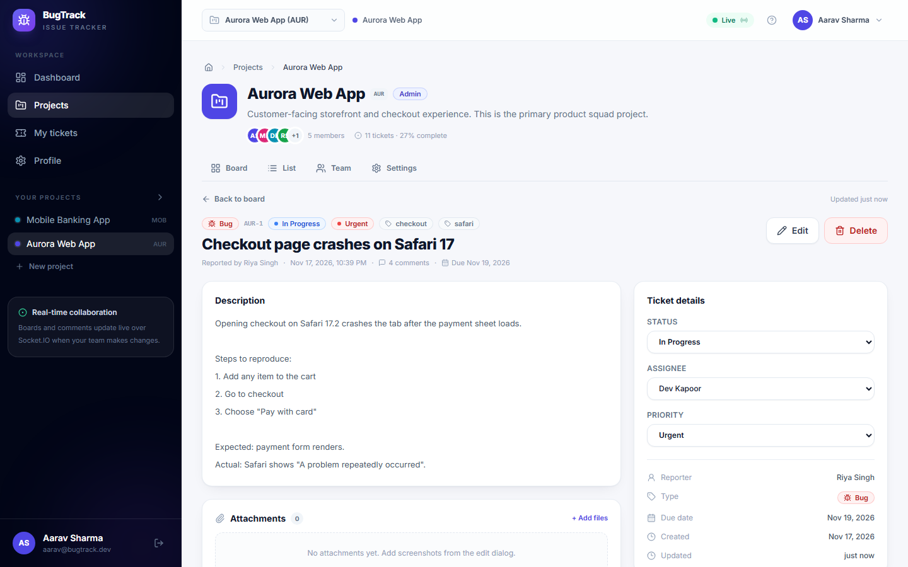

# 🐛 BugTrack — MERN Bug / Issue Tracker

A production-style, Jira/Linear-inspired issue tracker built with the **MERN stack**. Teams can create projects, report bugs and feature requests, assign tickets, drag them across a Kanban board, discuss work in threaded comments, filter/search, and manage access with project roles.

> **Two top-level apps:** [`backend/`](./backend) (Node + Express + MongoDB + Socket.IO) and [`frontend/`](./frontend) (React + Vite + Tailwind CSS).


---

## ✨ Screenshots

| Dashboard | Kanban board |
| --- | --- |
|  |  |

| Projects | Ticket discussion |
| --- | --- |
|  |  |

*(Screenshots are captured from the seeded demo workspace — see [Demo mode](#-quick-start).)*

---

## 🎯 Features

Everything requested in the project brief is implemented:

| # | Requirement | Status | Where |
| --- | --- | --- | --- |
| 1 | **User authentication** — register/login, JWT-protected routes | ✅ | `backend/src/controllers/authController.js`, `frontend/src/context/AuthContext.jsx` |
| 2 | **Project management** — create/update/delete projects, invite team members | ✅ | `backend/src/controllers/projectController.js`, `frontend/src/pages/ProjectsPage.jsx`, `TeamPage.jsx` |
| 3 | **Create issues** — bugs, features, tasks and improvements inside a project | ✅ | `backend/src/controllers/ticketController.js`, `TicketFormModal.jsx` |
| 4 | **Assign tickets** to members of the same project (validated server-side) | ✅ | `ticketController.js`, ticket detail sidebar |
| 5 | **Kanban board** — drag tickets between **To Do → In Progress → Done** | ✅ | `KanbanBoard.jsx` + `@hello-pangea/dnd` (maintained `react-beautiful-dnd`) |
| 6 | **Threaded comments** on tickets, with edit/delete and cascade delete | ✅ | `commentController.js`, `CommentThread.jsx` |
| 7 | **Filter & search** by status, priority, assignee, type and keyword | ✅ | `TicketFilters.jsx`, ticket list API |
| 8 | **Edit / delete tickets** with confirmation and permission checks | ✅ | `TicketFormModal.jsx`, `TicketDetailPage.jsx` |
| 9 | **Role-based access** — admin, manager, developer, viewer | ✅ | `backend/src/utils/permissions.js`, `TeamPage.jsx` |
| 10 | **Screenshot uploads** — images + PDFs via Multer | ✅ | `middleware/upload.js`, `AttachmentList.jsx` |

And the recommended extras:

- **Context API** for global auth, toasts, socket and projects state.
- **Socket.IO real-time collaboration** — ticket create/update/delete, comments and project changes sync live.
- **Helmet + CORS + dotenv** for security and configuration.
- **Multer** for screenshot/PDF attachments.
- **Responsive UI** with a sidebar/dashboard layout, project selector and breadcrumbs.
- **Loaders, skeleton screens and toast notifications** throughout.
- **Seeded demo workspace** and an **in-memory demo mode** that needs no local MongoDB.
- **End-to-end API tests** using Node's test runner + an in-memory MongoDB.

### Extra details that make it feel like a real tracker

- Sequential ticket keys per project (`AUR-1`, `AUR-2`, …) using an atomic counter.
- Kanban ordering persists (`position` is written with a bulk re-numbering operation).
- Overdue detection, due dates, labels, attachments and comments counts.
- Dashboard stats: assigned to me, open/in-progress/completed, completion rate, priority breakdown, recent activity.
- Assignees are validated against project membership; viewers cannot create or move tickets.
- Confirmation dialogs for destructive actions; toast feedback on every mutation.
- JWT rate limiting, Zod request validation, centralized error handling.

---

## 🧰 Tech stack

| Layer | Technology |
| --- | --- |
| Frontend | React 18, Vite, Tailwind CSS, React Router 6, Fetch API, Context API |
| Drag & drop | `@hello-pangea/dnd` (actively maintained fork of `react-beautiful-dnd`) |
| Backend | Node.js, Express 4, Socket.IO |
| Database | MongoDB + Mongoose (MongoDB Atlas or local) |
| Auth | JWT + bcryptjs |
| Uploads | Multer (images/PDF, 5 MB limit, max 3 per request) |
| Validation | Zod |
| Security | Helmet, CORS allow-list, express-rate-limit, sanitized error responses |
| Testing | Node `node:test`, Supertest, `mongodb-memory-server` |
| Deployment | Render/Railway (API), Vercel/Netlify (client), MongoDB Atlas |

---

## 📁 Project structure

```text
Project-bug management app/
├─ package.json                  # root convenience scripts (concurrently)
├─ README.md
├─ docs/screenshots/             # UI screenshots used above
│
├─ backend/
│  ├─ package.json
│  ├─ .env.example               # copy to .env
│  ├─ render.yaml / Procfile     # deployment configs
│  ├─ uploads/                   # ticket screenshots & PDFs (gitignored)
│  ├─ scripts/demo.js            # in-memory DB + auto-seeded demo
│  └─ src/
│     ├─ server.js               # HTTP server + Socket.IO bootstrap
│     ├─ app.js                  # Express app, middleware, routes
│     ├─ seed.js                 # demo users/projects/tickets/comments
│     ├─ config/                 # env + Mongo connection
│     ├─ models/                 # User, Project, Ticket, Comment
│     ├─ middleware/             # auth, validation, upload, errors
│     ├─ controllers/            # auth, users, projects, tickets, comments, dashboard
│     ├─ routes/                 # versionless REST routes under /api
│     ├─ socket/                 # authenticated Socket.IO rooms
│     ├─ utils/                  # permissions, serializers, helpers
│     └─ tests/api.test.js       # end-to-end API tests
│
└─ frontend/
   ├─ package.json
   ├─ vite.config.js
   ├─ tailwind.config.js
   ├─ vercel.json / netlify.toml
   ├─ .env.example
   └─ src/
      ├─ App.jsx                 # routes + providers
      ├─ context/                # Auth, Toast, Socket, Projects
      ├─ components/
      │  ├─ layout/              # AppShell, Sidebar, Topbar, Breadcrumbs, AuthLayout
      │  ├─ ui/                  # Button, Input, Modal, Avatar, Badge, etc.
      │  ├─ projects/            # ProjectCard, ProjectFormModal
      │  └─ tickets/             # Kanban, filters, table, comments, attachments
      ├─ pages/                  # Login, Register, Dashboard, Projects, Board, List,
      │                          # Team, Settings, TicketDetail, MyTickets, Profile, 404
      ├─ hooks/                  # useDebounce
      └─ lib/                    # api client, constants, formatters, permissions
```

---

## 🚀 Quick start

### Prerequisites

- **Node.js 18+** (tested with Node 24)
- **MongoDB** — either a local server or a free **MongoDB Atlas** cluster
- npm 9+

### Option A — Demo mode (no MongoDB install required)

This starts the API with an **in-memory MongoDB**, seeds the demo workspace automatically, and runs the React app.

```bash
# from the project root
npm install                 # installs concurrently for the root scripts
npm run install:all         # installs backend + frontend dependencies
npm run dev:demo
```

- Frontend: **http://localhost:5173**
- API: **http://localhost:5000**
- Data resets every time the backend stops (it is in-memory).

> The first run downloads a MongoDB binary for `mongodb-memory-server`, so it may take a minute.

### Option B — Local MongoDB / MongoDB Atlas (recommended)

1. **Configure the backend**

   ```bash
   cd backend
   copy .env.example .env      # Windows
   # cp .env.example .env     # macOS/Linux
   ```

   Edit `backend/.env`:

   ```env
   PORT=5000
   NODE_ENV=development
   MONGODB_URI=mongodb+srv://<user>:<password>@<cluster>.mongodb.net/bugtracker
   JWT_SECRET=replace-with-a-long-random-string
   CLIENT_URL=http://localhost:5173
   ```

2. **Install, seed, and start the API**

   ```bash
   npm install
   npm run seed                # add --force to wipe and reseed an existing DB
   npm run dev
   ```

   ```bash
   # npm run seed -- --force
   ```

3. **Configure and start the frontend**

   ```bash
   cd ../frontend
   copy .env.example .env
   npm install
   npm run dev
   ```

4. Open **http://localhost:5173** and sign in with a demo account.

### Root scripts

| Command | What it does |
| --- | --- |
| `npm run install:all` | Install backend + frontend dependencies |
| `npm run dev` | Run API and React app together |
| `npm run dev:demo` | Same, but API uses in-memory MongoDB + auto-seed |
| `npm run seed` | Seed the configured MongoDB |
| `npm run build` | Production build of the frontend |
| `npm test` | Run backend end-to-end API tests |

---

## 👤 Demo accounts

All seeded users use the password **`password123`**.

| Name | Email | Global role | Aurora project role | Mobile Banking role |
| --- | --- | --- | --- | --- |
| Aarav Sharma | `aarav@bugtrack.dev` | Admin | Admin (owner) | Admin |
| Meera Patel | `meera@bugtrack.dev` | User | Manager | Admin (owner) |
| Dev Kapoor | `dev@bugtrack.dev` | User | Developer | Developer |
| Riya Singh | `riya@bugtrack.dev` | User | Viewer | Viewer |
| Kabir Rao | `kabir@bugtrack.dev` | User | Developer | Manager |

The seed creates **2 projects** (Aurora Web App, Mobile Banking App), **16 tickets**, due dates, labels and **threaded comments**. Both projects include the full demo team, so the project selector, dashboard and project list show the combined workspace. New accounts start with an empty workspace and can create their own projects.

---

## 🔐 Roles & permissions

Roles are scoped **per project**, so the same person can be a manager in one project and a viewer in another.

| Action | Admin | Manager | Developer | Viewer |
| --- | :-: | :-: | :-: | :-: |
| View board, tickets, comments | ✅ | ✅ | ✅ | ✅ |
| Comment on tickets | ✅ | ✅ | ✅ | ✅ |
| Create / edit tickets | ✅ | ✅ | ✅ | ❌ |
| Drag tickets between columns | ✅ | ✅ | ✅ | ❌ |
| Assign tickets | ✅ | ✅ | ✅ | ❌ |
| Delete own ticket | ✅ | ✅ | ✅ | ❌ |
| Delete any ticket | ✅ | ✅ | ❌ | ❌ |
| Invite / remove members | ✅ | ✅* | ❌ | ❌ |
| Change roles | ✅ | ✅* | ❌ | ❌ |
| Edit project settings | ✅ | ✅ | ❌ | ❌ |
| Delete project | ✅ | ❌ | ❌ | ❌ |

\* Managers can only invite/remove **developers and viewers** and cannot modify admins, managers or the owner.

Global `admin` is the account-level role assigned to the first registered account (and seeded Aarav). Project access is always enforced by project membership on the server.

---

## 🔌 API reference

Base URL: `http://localhost:5000/api`. Protected routes require `Authorization: Bearer <token>`.

### Auth

| Method | Endpoint | Description |
| --- | --- | --- |
| POST | `/auth/register` | Create an account → `{ token, user }` |
| POST | `/auth/login` | Sign in → `{ token, user }` |
| GET | `/auth/me` | Current user |
| PATCH | `/auth/me` | Update name / avatar color |
| PATCH | `/auth/password` | Change password → new token |

### Users

| Method | Endpoint | Description |
| --- | --- | --- |
| GET | `/users?q=meera` | Search accounts for invites/assignment |

### Projects

| Method | Endpoint | Description |
| --- | --- | --- |
| GET | `/projects` | Projects the current user belongs to (with ticket stats) |
| POST | `/projects` | Create a project (`title`, `key?`, `description?`, `color?`) |
| GET | `/projects/:id` | Project with populated members + stats |
| PATCH | `/projects/:id` | Update title/description/color/status |
| DELETE | `/projects/:id` | Delete project + tickets + comments + files (admin) |
| POST | `/projects/:id/members` | Invite by email (`email`, `role`) |
| PATCH | `/projects/:id/members/:userId` | Change member role |
| DELETE | `/projects/:id/members/:userId` | Remove member |

### Tickets

| Method | Endpoint | Description |
| --- | --- | --- |
| GET | `/projects/:projectId/tickets` | List/filter tickets |
| POST | `/projects/:projectId/tickets` | Create a ticket |
| GET | `/tickets/mine` | Tickets assigned to the current user |
| GET | `/tickets/:id` | Single ticket + your project role |
| PATCH | `/tickets/:id` | Edit fields (status changes re-order the board) |
| DELETE | `/tickets/:id` | Delete ticket (permission-based) |
| PATCH | `/tickets/:id/status` | Move ticket (`status`, `position`) |
| POST | `/tickets/:id/attachments` | Multipart upload (`files`, max 3) |
| DELETE | `/tickets/:id/attachments/:attachmentId` | Remove attachment |

**Ticket list query parameters**

| Param | Values |
| --- | --- |
| `q` | Keyword in title, description, key, labels |
| `status` | `todo` · `in_progress` · `done` |
| `priority` | `low` · `medium` · `high` · `urgent` |
| `type` | `bug` · `feature` · `task` · `improvement` |
| `assignee` | user id · `me` · `unassigned` |
| `sort` | `newest` · `oldest` · `updated` · `priority` · `dueDate` · `order` |
| `page`, `limit` | Pagination (max 200 per page) |

### Comments

| Method | Endpoint | Description |
| --- | --- | --- |
| GET | `/tickets/:ticketId/comments` | Threaded comment tree |
| POST | `/tickets/:ticketId/comments` | Add comment or reply (`parentId`) |
| PATCH | `/comments/:id` | Edit your comment |
| DELETE | `/comments/:id` | Delete your comment (moderators can delete any; replies cascade) |

### Dashboard & health

| Method | Endpoint | Description |
| --- | --- | --- |
| GET | `/dashboard/summary` | Stats, priority breakdown, my tickets, recent activity |
| GET | `/health` | Health check for deployment probes |

### Socket.IO events

Authenticated with `auth.token`; clients automatically join rooms for projects they belong to.

| Event | Direction | Payload |
| --- | --- | --- |
| `ticket:created` / `ticket:updated` | server → client | Serialized ticket |
| `ticket:deleted` | server → client | `{ ticketId, projectId }` |
| `comment:created` / `comment:updated` | server → client | Serialized comment |
| `comment:deleted` | server → client | `{ ticketId, commentIds }` |
| `project:updated` | server → client | Serialized project |
| `project:deleted` / `project:removed` | server → client | `{ projectId }` |
| `project:join` | client → server | `projectId` (used when joining a newly added project) |

---

## 🗓 2-week delivery map

| Day | Planned work | Implemented |
| --- | --- | --- |
| 1 | MERN setup, Tailwind, Express, MongoDB | Vite React app, Tailwind design system, Express + Mongoose connection |
| 2 | Auth model, register/login, JWT + bcrypt, login state | Full auth + profile + password change + protected routes |
| 3 | Project schema, CRUD, members | Projects CRUD, roles, member invite/remove, project selector |
| 4 | Ticket model + APIs + auth middleware | Tickets CRUD, filters, assignment, sequential keys, status reorder |
| 5 | Ticket form + list UI | Create/edit modal, ticket table, metadata |
| 6 | Dashboard layout, sidebar, selector, breadcrumbs, responsive | AppShell, responsive sidebar/topbar, dashboard, breadcrumbs |
| 7 | Testing, API checks | Supertest E2E suite, seed data, error handling |
| 8 | Kanban drag-and-drop + save status | `@hello-pangea/dnd` board, optimistic moves, persisted order |
| 9 | Comments schema + UI | Threaded comments, replies, edit/delete, live updates |
| 10 | Filters + search | Server-side filters/search/sort, search UI |
| 11 | Edit/delete + authorization | Edit modal, confirmation dialogs, server-side permissions |
| 12 | Deployment | Render/Railway + Vercel/Netlify configs, env docs |
| 13 | Polish, loaders, toasts, README | Skeletons, toasts, empty states, this README + screenshots |
| 14 | Final testing | Automated API tests + manual end-to-end flows |

---

## ⚙️ Environment variables

### Backend (`backend/.env`)

| Variable | Default | Notes |
| --- | --- | --- |
| `PORT` | `5000` | API port |
| `NODE_ENV` | `development` | `production` hides stack traces |
| `MONGODB_URI` | `mongodb://127.0.0.1:27017/bugtracker` | Local or Atlas URI |
| `JWT_SECRET` | dev fallback | **Required** in production |
| `JWT_EXPIRES_IN` | `7d` | Token lifetime |
| `CLIENT_URL` | `http://localhost:5173` | Comma-separated CORS allow-list |
| `UPLOAD_DIR` | `uploads` | Attachment storage |
| `MAX_FILE_SIZE_MB` | `5` | Per-file limit |
| `AUTO_SEED` | `false` | Seed when the DB is empty (demo) |
| `USE_MEMORY_DB` | `false` | Start an in-memory MongoDB (demo/tests) |

### Frontend (`frontend/.env`)

| Variable | Default | Notes |
| --- | --- | --- |
| `VITE_API_URL` | `http://localhost:5000/api` | REST base URL |
| `VITE_SOCKET_URL` | `http://localhost:5000` | Socket.IO origin |

---

## 🧪 Testing

```bash
# from the project root
npm test

# or
cd backend
npm test
```

The suite covers:

- health check, registration, login, invalid credentials, protected routes
- project creation, invites, role-scoped access
- ticket creation, sequential keys, filters/search, assignment
- viewer restrictions, comments and threaded replies with cascade delete
- ticket updates, Kanban status moves, dashboard stats
- attachment upload/delete
- project/ticket delete permissions and cleanup

Tests use `mongodb-memory-server`, so they do not touch your development database.

---

## ☁️ Deployment

### Backend — Render (or Railway)

**Blueprint:** `backend/render.yaml` is included. Point Render at the repo and apply the blueprint, then set:

- `MONGODB_URI` — your Atlas connection string
- `CLIENT_URL` — e.g. `https://bugtrack.vercel.app`
- `JWT_SECRET` — generated automatically by the blueprint (or set your own)

Manual setup:

| Setting | Value |
| --- | --- |
| Root directory | `backend` |
| Build command | `npm install` |
| Start command | `npm start` |
| Health check | `/api/health` |

Railway works the same way (`backend/Procfile` included).

### Frontend — Vercel (or Netlify)

- **Vercel:** import the repo, set **Root Directory** to `frontend`, framework **Vite**. Add `VITE_API_URL` and `VITE_SOCKET_URL` environment variables. `frontend/vercel.json` handles SPA rewrites.
- **Netlify:** `frontend/netlify.toml` already sets build command, publish directory and SPA redirects. Add the same two environment variables.

### MongoDB Atlas

1. Create a free cluster.
2. Add a database user and allow your deployment IPs (`0.0.0.0/0` is acceptable for a demo, not for production).
3. Copy the connection string into `MONGODB_URI` (include the database name, e.g. `/bugtracker`).
4. Optionally run `npm run seed -- --force` locally against Atlas to populate the demo data.

> **Uploads on free hosting:** Render/Railway container disks are ephemeral. Attachments are stored in `backend/uploads` by default. For durable production uploads, swap the Multer storage for Cloudinary/S3 (the attachment model already stores a URL).

---

## 🔒 Security notes

- Passwords hashed with **bcrypt** (cost 12); never returned by the API.
- JWT signed with `JWT_SECRET`; expiring tokens; `401` clears the client session.
- **Helmet** headers and a strict **CORS allow-list** (`CLIENT_URL`).
- Rate limiting on auth endpoints (60 attempts / 15 min) and the API.
- **Zod** validation for every request body; Mongoose schema validation underneath.
- Membership and role checks on every project/ticket/comment operation — not just in the UI.
- Attachment MIME allow-list (images/PDF), 5 MB limit, randomized filenames.
- Server-side assignee validation ensures assignees belong to the project.
- Delete operations cascade cleanly (tickets → comments → attachment files).

---

## 🧭 Product tour

1. **Sign in** with `aarav@bugtrack.dev` / `password123`.
2. **Dashboard** → see assigned work, completion rate, priority mix and recent activity.
3. **Aurora Web App → Board** → drag “Checkout page crashes on Safari 17” from *In Progress* to *Done*; the status and order persist.
4. **Filters** → search `safari`, filter by priority `urgent` and assignee `Dev Kapoor`.
5. **Open a ticket** → change status/assignee/priority inline, download a screenshot, reply in the thread.
6. **Team** → invite a user by email, promote them to developer, or remove them.
7. **Settings** → archive the project or (as admin) delete it with confirmation.
8. Open a second browser/incognito window and watch comment/ticket changes arrive **live**.

---

## 🛠 Troubleshooting

| Problem | Fix |
| --- | --- |
| `MongooseServerSelectionError` | Start MongoDB locally or set a valid Atlas `MONGODB_URI`; check Atlas IP allow-list |
| CORS error in the browser | Add the frontend origin to `CLIENT_URL` (comma-separated) and restart the API |
| Login works but API returns 401 | Ensure `JWT_SECRET` is stable; old tokens become invalid if the secret changes |
| `mongodb-memory-server` download fails | Use the local MongoDB/Atlas path instead, or allow the postinstall script and retry |
| Invite says “No account exists” | The person must register first; invites target existing accounts |
| Attachments disappear after redeploy | Ephemeral disk — use object storage for production |
| Port already in use | Change `PORT` (backend) / Vite `server.port` (frontend) |

---

## 📄 License

MIT — free to use for learning, portfolios and internal projects. Demo data and branding are fictional.

---

Built with the MERN stack, Tailwind CSS and Socket.IO. Happy bug hunting! 🐞
